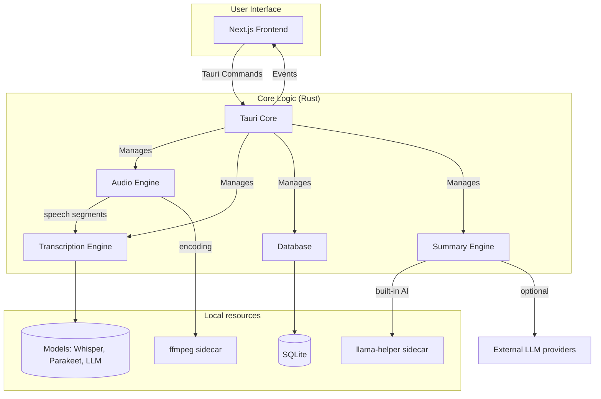

# System Architecture

Meetily is a self-contained desktop application built with [Tauri](https://tauri.app/). It combines a Rust-based backend with a Next.js frontend into a single, efficient, and cross-platform application.

There is no separate server: audio capture, transcription, storage and summary orchestration all run
inside the Tauri process. The app's own network traffic is limited to model downloads (Hugging Face
and the upstream project's model mirror), the update check (upstream's GitHub releases for standard
builds, this fork's releases for the daily app built by `install_local.sh`; see
[local-workflow.md](../development/local-workflow.md)), opt-in analytics (PostHog), and calls to the
LLM provider the user selects (a local Ollama server or a cloud API).

## High-Level Architecture Diagram



## Component Details

### Frontend (Next.js)

*   Provides the user interface for managing meetings, displaying transcriptions, and configuring the application.
*   Communicates with the Rust core through Tauri's command system, and receives live updates through Tauri events.
*   Built as a static export (`frontend/out`) that Tauri loads; there is no Node server at runtime.
*   Code: `frontend/src/` — see [frontend/src/AGENTS.md](../../frontend/src/AGENTS.md).

### Backend (Rust Core)

*   **Tauri Core:** The heart of the application, responsible for managing the window, handling events, and exposing the Rust core to the frontend (`frontend/src-tauri/src/lib.rs`).
*   **Audio Engine:** Captures audio from the microphone and system, processes it, and prepares it for transcription. See [audio-pipeline.md](audio-pipeline.md).
*   **Transcription Engine:** Uses local speech-to-text models (Whisper or Parakeet) to transcribe the captured audio. It can be accelerated with a GPU. See [transcription.md](transcription.md).
*   **Database:** A local SQLite database that stores meeting metadata, transcripts, and summaries. See [data-storage.md](data-storage.md).
*   **Summary Engine:** Generates meeting summaries using various Large Language Models (LLMs): a built-in local model, Ollama, or a cloud/custom provider the user configures. See [summarization.md](summarization.md).

Code: `frontend/src-tauri/` — see [frontend/src-tauri/AGENTS.md](../../frontend/src-tauri/AGENTS.md).

### Processes

| Process | Role |
|---|---|
| Meetily (Tauri app) | UI webview + Rust core; everything above |
| `llama-helper` | Sidecar binary (`llama-helper/` crate) that runs the built-in local LLM for summaries |
| `ffmpeg` | Sidecar binary used for audio encoding and conversion; downloaded at build time by `build.rs` |
| Ollama (optional) | Separate local server the user installs; Meetily talks to it over HTTP |

## How the UI and the Rust core talk

**Commands (UI → Rust).** The UI calls `invoke('command_name', { camelCaseArgs })`; Tauri maps the
arguments to snake_case parameters of a `#[tauri::command]` function, which returns
`Result<T, String>`. All commands are registered in `tauri::generate_handler![...]` in `src/lib.rs`.

```ts
// frontend/src/services/recordingService.ts
await invoke('start_recording_with_devices_and_meeting', { /* devices, meeting name */ });
```

```rust
// frontend/src-tauri/src/audio/recording_commands.rs
#[tauri::command]
pub async fn start_recording_with_devices_and_meeting<R: Runtime>(app: AppHandle<R>, /* ... */)
    -> Result<(), String> { /* ... */ }
```

**Events (Rust → UI).** Rust calls `app.emit("event-name", payload)`; the UI subscribes with
`listen('event-name', handler)`. Event names are kebab-case, e.g. `recording-started`,
`transcript-update`, `transcription-progress`, `model-download-progress`.

## Life of a meeting

1. **Start.** `useRecordingStart` (UI) → `recordingService` → command
   `start_recording_with_devices_and_meeting` (`audio/recording_commands.rs`) →
   `audio/recording_manager.rs` opens the microphone and system streams, and `audio/recording_saver.rs`
   creates the meeting folder. Rust emits `recording-started`.
2. **Capture.** `audio/pipeline.rs` resamples both streams, mixes them for the recording file, and
   sends speech segments (after voice activity detection) to the transcription worker.
3. **Live transcript.** `audio/transcription/worker.rs` transcribes each segment with Whisper or
   Parakeet and emits `transcript-update`; the UI shows it and also writes it to IndexedDB for crash recovery.
4. **Stop.** `useRecordingStop` → command `stop_recording` → the recording is finalized on disk.
   The UI saves the meeting with `api_save_transcript` (this creates the database row), applies the
   title typed during recording, and opens `/meeting-details?id=...&source=recording`.
5. **Summary.** The details page starts `api_process_transcript`; `summary/service.rs` runs the
   selected LLM in the background and the UI polls `api_get_summary` until it completes.

## App identity and data

| Build | App identifier | Data folder (macOS) |
|---|---|---|
| Installed app | `com.meetily.ai` | `~/Library/Application Support/com.meetily.ai/` |
| Dev build (`pnpm run tauri:dev`) | `com.meetily.ai.dev` | `~/Library/Application Support/com.meetily.ai.dev/` |

Database, models, settings and recordings locations are described in [data-storage.md](data-storage.md).
How this fork runs both builds side by side is described in [local-workflow.md](../development/local-workflow.md).
